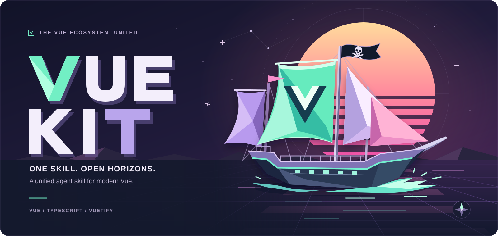

# Vue Kit

A unified Agent Skill for Vue 3.5 applications: TypeScript, Composition API, Vuetify-first UI and explicit ecosystem version boundaries. The master index routes agents to focused capability references and cross-library architecture instead of loading an entire skills collection.

## Install

Run from the project where your coding agent should receive the skill. **Bun is preferred**; the npm-compatible installer is also supported:

```sh
# Preferred
bunx skills add PhilosophiMoonbeam/vue-kit-skills

# npm-compatible installer
npx skills add PhilosophiMoonbeam/vue-kit-skills
```

Select `vue-kit` and your target agents when prompted. Installation is project-scoped by default; use the Skills CLI's `--global` option only when a user-wide installation is intended. The current Skills CLI requires Node.js 22.20 or later. See the [installer reference](https://github.com/vercel-labs/skills/blob/main/docs/commands.md#skills-add) for noninteractive, agent-selection and copy options.

## Navigate the skill

Install the skill for metadata-based discovery; do not preload its body or all references into every session. When a Vue task activates it, read [`skills/vue-kit/SKILL.md`](skills/vue-kit/SKILL.md), select the task's owning reference, and add companions only for decisions the change actually touches.

- **40 capability references:** Vue/reactivity, first-class Nuxt, components/composables, state, application-owned session boundaries, routing, server-state caches, forms, UI frameworks, accessibility, tables, virtualization, visualization, motion, localization, SSR, testing, self-hostable AI streaming and tooling.
- **Architectural synthesis:** [application boundaries](skills/vue-kit/references/architecture.md), [data ownership and lifetimes](skills/vue-kit/references/architecture-data.md), and [UI composition](skills/vue-kit/references/architecture-ui.md).
- **Nuxt:** [framework ownership and complete application](skills/vue-kit/references/nuxt.md), then [selected Vuetify/Pinia/Colada integrations](skills/vue-kit/references/nuxt-integrations.md) only when needed. Nuxt owns bootstrap, routing and SSR; standalone Vue examples are not module recipes.
- **Preferred baseline:** Vue **3.5.44** and pinned authoring Vuetify **4.3.0**, with **4.3.x** preferred for new general-purpose UI. Alternative libraries and incumbent major versions retain their own compatibility boundaries; preference is not permission for an unrequested migration.
- **OpenVue:** the designated alternative UI route is **OpenVue 1.x and newer**, authored against **1.0.0**, with MIT-licensed core/themes and no account or license key. See [the integration and ancestry boundary](skills/vue-kit/references/alternative-ui.md). Verify each future major before using its APIs; Vuetify remains the default.
- **No implied outside services:** no hosted identity SDK, provider-key management, cloud account provisioning or required commercial service. Session helpers define application-owned contracts; streaming can target an application-owned or self-hosted backend; documentation search stays local.
- **Package manager:** prefer Bun **1.4.3** for equivalent install, add, script and executable workflows. Respect an existing project's explicitly selected manager and authoritative lockfile unless migration is requested. Bun package management does not automatically change Node-based tooling into Bun-runtime tooling.

The installed skill is self-contained. Historical source paths in audit assets identify provenance; the original `.agents/skills/` corpus and a private discovery service are not installation dependencies.

## Run the example workbench

The bundled Vue/Vuetify/Pinia/Router application implements real in-memory tasks, validation, keyboard interaction, confirmation dialogs, navigation and theme changes. It has no backend, account, credentials or persistence; reload restores its example state.

Use Bun **1.4.3** and supported Node.js **24.15.0** for the recorded environment:

```sh
cd skills/vue-kit/assets/example-app
bun install --frozen-lockfile
bun run typecheck
bun run build
bun run dev
```

The committed `bun.lock` is authoritative. Keep type checking separate from Vite bundling; a build alone does not prove types or behavior. See [setup and tooling](skills/vue-kit/references/setup-tooling.md) for prerequisites, lockfile migration and dependency lifecycle-script boundaries.

## Inspect the retained WebGPU recipe

The optional [browser verification lab](verification/webgpu/) runs extracted examples from [TresJS](skills/vue-kit/references/tresjs.md), outside the installed skill. Rendering uses the **viewing device's browser/GPU**; Node only serves static files. It defaults to **Normal · no injection**: native GPU/canvas methods remain unchanged. Other cases explicitly deny adapter, device or WebGL2 fallback access. Each start creates a fresh iframe; unmount preserves error observers. Source/hash links, direct canvas readback and browser-local JSON downloads let a second observer inspect the same experiment.

```sh
bun install --frozen-lockfile --cwd verification/webgpu
bun run --cwd verification/webgpu build
bun run --cwd verification/webgpu start
```

The backend listens only on `127.0.0.1:45875`. For optional access through an already configured tailnet, add an unused HTTPS Serve port without changing existing routes:

```sh
tailscale serve --bg --https=11453 --yes http://127.0.0.1:45875
```

Use the HTTPS URL printed by the command; it provides the secure context WebGPU requires. This is tailnet-only Serve, not public Funnel. Keep the backend running; remove only this route with `tailscale serve --https=11453 off`. Tailscale is an optional verification-host tool, not a dependency of the skill or recipe. No telemetry, uploads or account credentials are required by the lab.

Normal rendering and deliberately failed initialization are separate observations. A headless software adapter does not certify native hardware; a blank screenshot or discarded-buffer readback alone does not establish a rendering failure. The recipe remains experimental and retained, with the bounded observations recorded below.

## Validate and inspect evidence

From the repository root:

```sh
python3 skills/vue-kit/scripts/validate.py skills/vue-kit --json
```

The standard-library validator checks skill structure, reference navigation, retained source identity/native-hypothesis fingerprints, current ownership and content-addressed packaged files. It does not execute optional integrations or confer runtime certification.

[Sources and verification policy](skills/vue-kit/references/sources.md) explain the revised provenance population: **47 retained historical roots, 459 documents and 327 original triage flags**, plus separately identified OpenVue and application-session contract extensions. One retained nine-document root remains an explicit presentation-integration exclusion; it is not supported guidance. [Coverage routing](skills/vue-kit/assets/coverage-audit.json) preserves the retained hashes and native hypotheses without pretending historical dispositions validate revised examples.

Superseded audit bodies and runtime reports remain in repository history at commit `7bf433b98951918c694358e372d3b02cf6f982e5`, outside the installable skill. They were not edited into fresh results. The [current verification record](skills/vue-kit/assets/verification.json) distinguishes retained cutover checks from later generated-Nuxt, production-browser transport, local HTTP, router and graphics observations, including their source profiles and limits. No complete server authentication implementation, exhaustive SSR matrix or blanket accessibility certification is implied.

The [fifth-pass audit](skills/vue-kit/assets/fifth-pass-audit.json) records a separate review of the current Markdown corpus, not a replacement source audit or confirmed-bug count; [counts and evidence scope](skills/vue-kit/references/sources.md#fifth-pass-review-and-scoped-corrections) distinguish native risks from dispositions. Named checks exercised tween lifetime, router search/deferred results, cache identity retirement, form submission/native controls, VueUse target ownership and VitePress local-search exclusion, alongside strict consumers, unit fixtures and syntax/template compilation. The parent-applied VueUse next-frame measurement correction was production-browser verified after the original handoff. Vue I18n worked with both `runtimeOnly` settings, overturning the proposed compiler-removal failure rather than proving a failing-before repair. These observations do not rerun every optional integration or change service-independent contracts, existing removals or experimental WebGPU limits.

**Removed presentation integration:** the earlier slide-authoring/tooltip integration remains excluded because its tested desktop compatibility patch failed at startup. See the [decision and reintroduction criteria](skills/vue-kit/references/sources.md#removed-integrations). [VitePress documentation](skills/vue-kit/references/docs-vitepress.md) and the unrelated Floating UI adapter remain supported.
